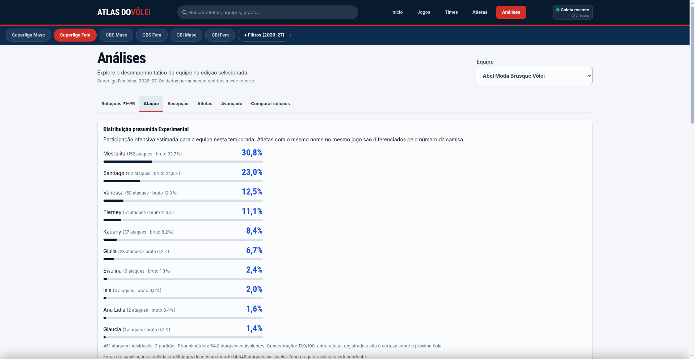

# Vôlei BR — Atlas Tático

[Consultar a publicação](https://lucaaregis4r-ops.github.io/Dados-Voleibr/)

Scouting de voleibol com Python, DuckDB, FastAPI e HTML estático. Quadras, matrizes
de rotação e replay usam fontes reconciliadas; cada medida expõe amostra e origem.

## Painel



*Captura da publicação em 21 de outubro de 2026. A cobertura varia conforme competição, temporada e dados disponíveis.*

## Executar

```bash
python3 -m venv .venv
source .venv/bin/activate
pip install -r requirements.txt
pip install -e .
python -m cbv app
# Alternativa: ./executar.sh
```

## Navegação

- **Início:** partidas recentes e agendadas, atletas em destaque e equipes da edição.
- **Jogos:** partidas encerradas e calendário; detalhe com placar, sets, fases,
  atletas e saldo de rotação conforme os dados disponíveis.
- **Times:** perfil da equipe e áreas de visão geral, rotações P1–P6, ataque,
  recepção, atletas e análises avançadas.
- **Atletas:** busca, elenco da temporada, perfil e comparação.
- **Análises:** entrada direta para rotações, ataque, recepção, atletas e análises
  avançadas. “Comparar edições” coloca lado a lado temporadas da mesma competição,
  categoria, gênero e equipe; cada coluna mantém sua própria amostra.
- **Filtros:** Superliga, CBS e CBI, com categoria, gênero e temporada no contexto
  selecionado. Agregados e modelos não combinam temporadas.
- **Confrontos e comparações:** dock para comparar duas equipes ou dois atletas;
  projeções permanecem identificadas pela classificação e avaliação do modelo.
- **Fontes e métodos:** o selo de coleta abre a saúde das fontes; cada indicador
  abre fórmula, classe, amostra, intervalo e limitações. O caderno metodológico e
  os documentos de auditoria detalham definições e proveniência.

O site usa o HTML gerado pelo exportador e fatias JSON locais para carregar dados
detalhados sob demanda. Não depende de scripts, fontes ou endpoints de terceiros
para navegar. As fontes Inter/Roboto Mono são locais, e as licenças SIL OFL estão
preservadas. Layout verificado em 1440, 1024, 768, 390 e 320 px.

## Definições e limites

SO/BP creditados no Match Report não equivalem a todos os pontos de placar. A
sequência completa é reconstruída das passagens de saque da súmula e mantém uma
série separada. Não há autoria de ação ou timestamp inventado. A rotação absoluta
exige marcador independente da levantadora inicial; presença real exige controle
de líbero e substituições reconciliados.

O widget play-by-play retornou HTTP 403. O coletor registra esse estado e preserva
fontes acessíveis; não há cobertura observada desse feed. Um adaptador estrito de
importação está disponível para schema explicitamente confirmado.

WP, WPA, leverage, expected metrics e ajustes novos são experimentais. O baseline
pré-jogo logístico L2 permanece ativo, com validação temporal em blocos de dia e
comparação comum com challenger de intercepto. Modelos mais complexos não são
promovidos automaticamente. Não confundir associação, on/off e efeito causal.

- [Caderno metodológico gerado do registry](docs/CADERNO_METODOLOGICO.md)
- [Limitações, cobertura e operação](docs/LIMITACOES_ATLAS.md)
- [Auditoria das fontes e definições](docs/AUDITORIA_ATLAS.md)
- [Contexto do produto](docs/PRODUCT.md)
- [Inventário de funcionalidades e arquitetura](docs/INVENTARIO_FUNCIONALIDADES.md)
- [Plano de refatoração](docs/PLANO_REFATORACAO.md)

```bash
python -m cbv backfill --competition superliga --season 2025-2026
python -m cbv backfill --cached-only
python -m cbv.metrics.methodology
python scripts/daily_update.py
```

O backfill é resumível, limitado em requisições e idempotente por hash. A rotina
diária às 03:00 BRT constrói banco e artefatos em staging, executa quality gates e
preserva o último resultado válido em caso de falha. CI de código e sincronização
de dados são workflows separados. Raw snapshots ficam fora do Git, com cache e
artefatos temporários no Actions; retenção permanente exige arquivo externo.

## Coleta e exportação

```bash
python -m cbv sync --url "https://cbv.com.br/volei-de-quadra/cbs/2026/feminino/sub-18-especial"
python -m cbv scrape-game 2590834
python -m cbv rankings --min-attack 15 --min-serve 10
python -m cbv export csv
python -m cbv export json
python -m cbv predict "SADA CRUZEIRO VÔLEI" "ITAMBÉ MINAS"
python -m cbv model-accuracy
python -m cbv retry-failed
```

O workflow `.github/workflows/daily_sync.yml` roda às 03h BRT, executa a coleta
existente e atualiza banco/exportações/páginas. A exportação HTML escreve
`exports/dashboard.html`, `index.html` e `docs/index.html` a partir da mesma fonte.
Caches de dossiês e papéis táticos são invalidados após ingestão bem-sucedida.
A data de geração do HTML é diferente da data de inserção/consulta à fonte.

## Desenvolvimento

```bash
pytest -q
python -c "from cbv.export.html_dashboard import export_dashboard_html; export_dashboard_html()"
# QA opcional das quatro larguras; usa o Chromium de teste do Playwright
pip install playwright
python -m playwright install chromium
python scripts/check_dashboard_ui.py
```

- `cbv/export/templates/scouting.html`: interface compartilhada por local e Pages.
- `cbv/analysis/scouting.py`: taxas, cobertura, Wilson, percentil, shrinkage e tendência (cálculos preservados).
- `cbv/analysis/temporal.py`: treinamento e validação cronológica.
- `cbv/metric_definitions.py`: catálogo versionado, materializado no DuckDB.
- `docs/METRIC_SOURCES.md`: fontes verificadas e limites metodológicos internos.
- `docs/REFORMULATION.md`: escopo implementado e dependências de eventos.

A API `/api/data` agora oferece `cohorts`, com estatísticas e validação por recorte;
consumidores do payload antigo devem migrar para essa estrutura. Campos preditivos
sem evidência retornam null. `/api/setter-distribution` permanece experimental.

## Temporadas e legenda

O Atlas abre a edição atual confirmada pela CBV, atualmente **2026–2027** para a
Superliga. **2025–2026** aparece como encerrada. Cada temporada mantém seus próprios
agregados, rankings, atletas, tendências e treinos; uma amostra insuficiente não
puxa automaticamente estatísticas da edição anterior. O calendário e a coleta
diária acompanham as páginas oficiais atuais dos dois gêneros.

**Legenda**, no menu, explica siglas e variáveis, com busca e catálogo de fórmulas.
Cada página também oferece **Como ler as variáveis desta página**. O contexto da
temporada e um acesso à legenda ficam visíveis em todas as áreas.
